# SpyTech IAM Lab Part 1: Authentication and Accounting in Okta

SpyTech is a fake company I made up for this lab. It has 5 departments and 5 new hires. My job was to set up how they sign in and make sure there's a record of every sign-in.

I split this project using the AAA framework. Part 1 covers authentication (proving who you are) and accounting (keeping a record of what happened). Part 2 will cover authorization (what you're allowed to get into).

Everything here lives in my personal Okta lab. None of these users or emails are real.

---

## How I planned it

I planned this on paper before I touched Okta. I built the plan around AAA, practiced it first in Keycloak, then brought the same plan over to Okta.

My first page is the plan. I think of the identity provider like a badge office. It checks who you are and hands you a signed digital ID that says something like "this is Alex, he's in Finance." From there I broke the build into authentication, authorization, and accounting, and wrote down what goes in each one.

My second page is how SSO works. I drew it out because I wanted to understand the flow, not just click buttons. The app sends you to the identity provider, you log in once, and it remembers you with a session cookie. When you open a second app, the identity provider sees you're already logged in and hands you a badge with no login screen. I also wrote down the difference between the session cookie and the refresh token, because I mixed those two up at first.

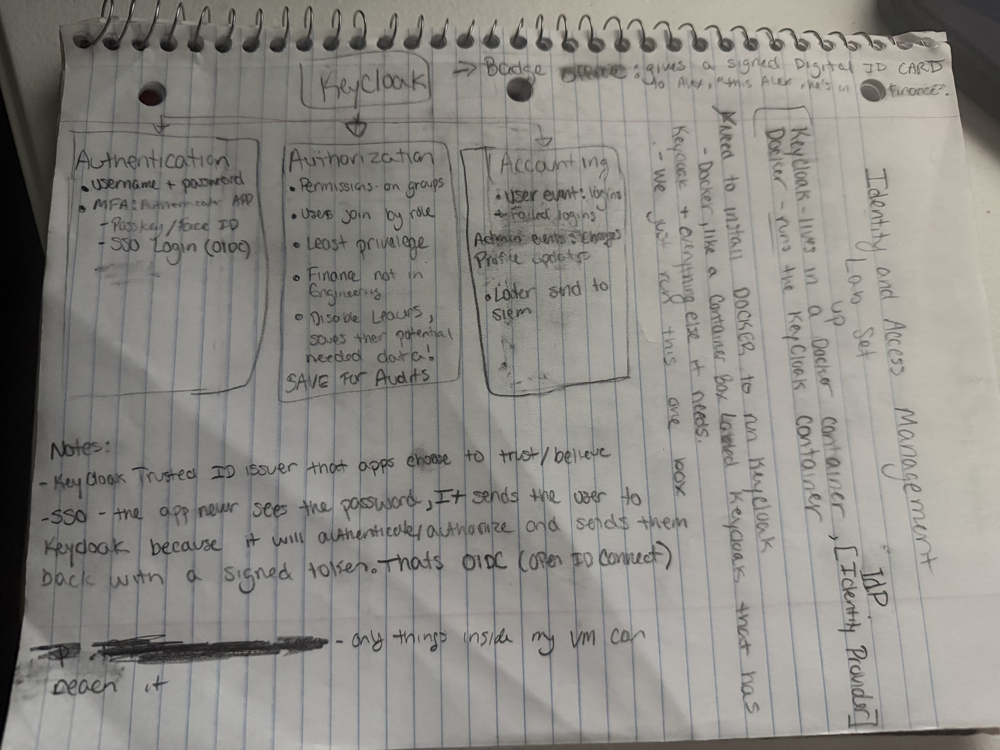 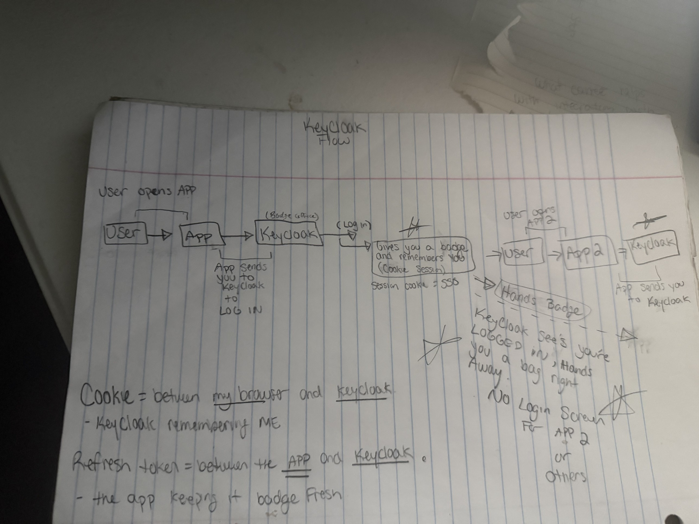

---

## The ticket

My manager in this scenario asked for MFA on the Finance and IT departments, since they handle money and admin access.

I worked it like a real ticket queue. Set up the org, make the department groups, onboard the new hires, then roll out MFA and prove it works.

---

## What I did and why

### Groups and new hire accounts

I made a group for every department and put each new hire in their group when I created their account. Everyone got a temporary password that they have to change the first time they log in.

**Why I did it:** I want access tied to groups, not to individual people. If someone moves departments or leaves, I change their group and their access follows. The temporary password is so IT never knows anyone's real password. Only the user does.

### MFA for every user

**Security > Authenticators > Enrollment**

- Made a policy called **MFA Required - All Users** and assigned it to everyone
- Changed Okta Verify from optional to **required**
- Password stays **required**
- Left passkeys **optional** for anyone who wants an even stronger sign-in
- Turned email **off** as a sign-in option
- Set the grace period to **none**
- Added a rule called **Enroll on first sign-in**

**Why I did it:** Passwords can be guessed and cracked. If a password is the only thing protecting an account, anyone who gets that password is in. Okta Verify makes the user approve the sign-in with their phone's passcode or biometrics like Face ID, and that's a lot harder to fake or bypass than a password.

I turned email off because if someone gets into your email, they get your codes too. I set no grace period because a "remind me later" button just means accounts stay password-only for longer.

**Something I learned:** In Okta, the policy is what makes MFA required. The rule only decides when enrollment happens, like on first sign-in. A rule by itself doesn't make anything required.

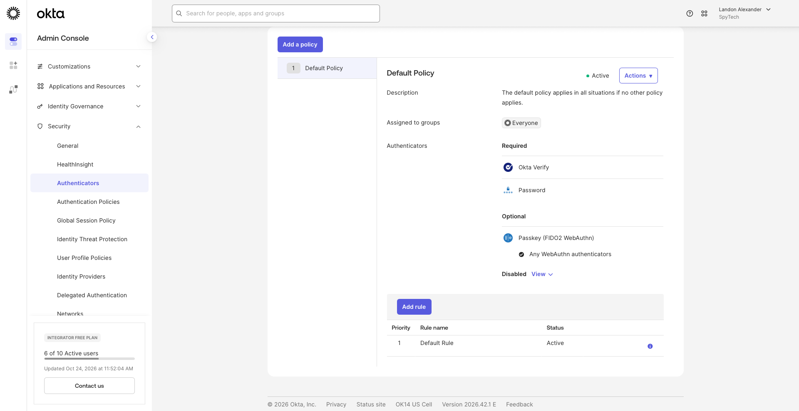

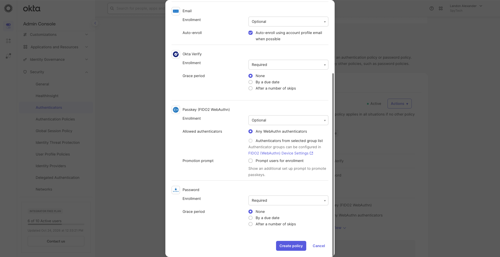 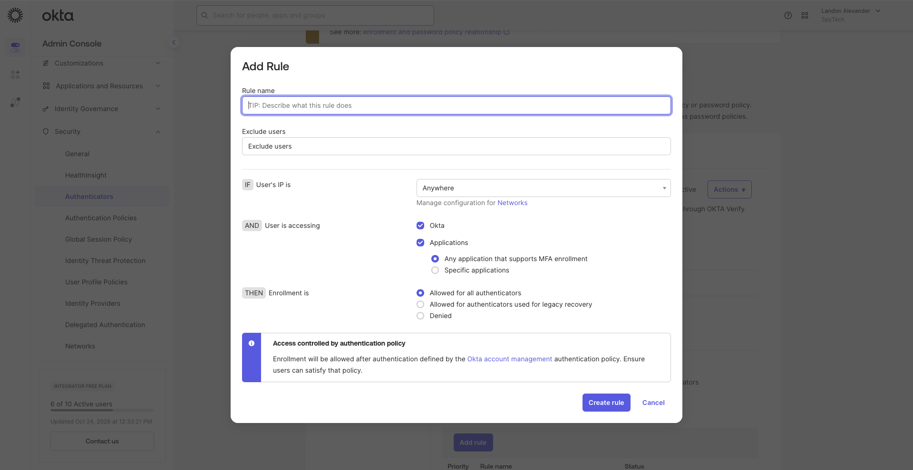

### Making Okta ask for MFA at every sign-in

**Security > Global Session Policy**

- Made a policy called **MFA Required - All Users (Session Limits)**, assigned it to everyone, and put it at the top so it runs first
- Added a rule called **Required MFA at every sign-in**

**Why I did it:** The last step makes people set up MFA. This step makes Okta actually ask for it when they log in. Without this, someone could set up Okta Verify and never get asked for it. I wanted authentication to stay true every single time, not just the first time.

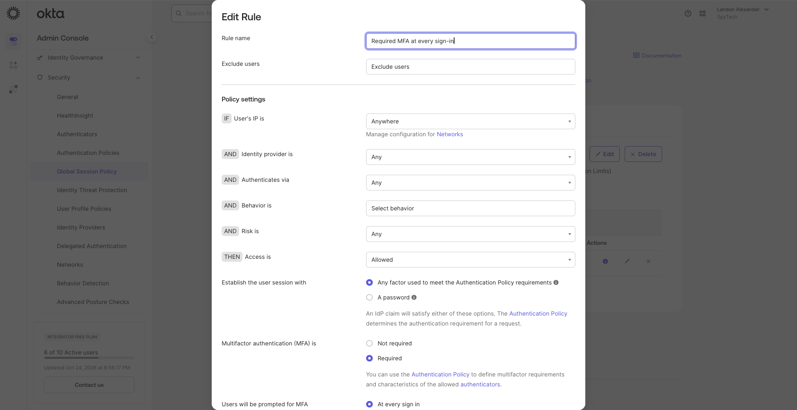 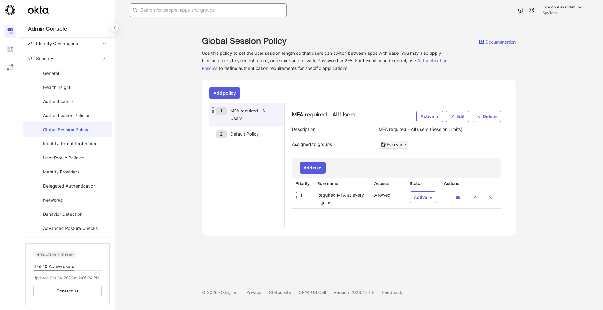

### Password rules

- Account locks after **5 failed sign-in attempts**
- No first or last name allowed in the password

**Why I did it:** The lockout lowers the risk of brute force. Without it, someone can keep guessing passwords forever. Blocking names takes away some of the easiest guesses, like "Maria2026."

### Session limits

- Max session: **12 hours**
- Idle timeout: **30 minutes**
- Sessions end when the browser closes

**Why I did it:** A session is what keeps you logged in after you sign in. If someone steals it, they don't need your password or your MFA. So I kept sessions short. The 30 minute idle timeout covers someone walking away from their laptop. The 12 hour max means everyone signs in fresh with MFA every workday.

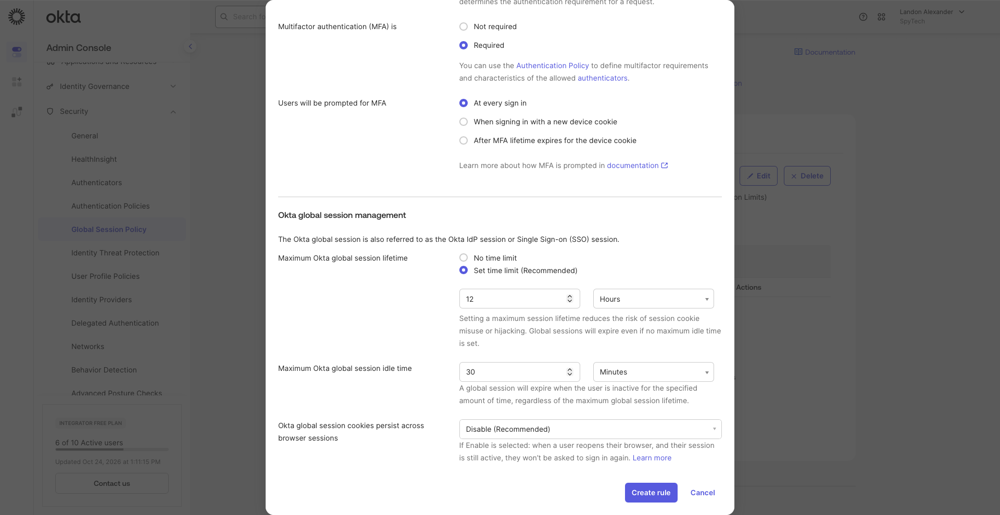

### Logging

Okta logs sign-ins and admin changes by default. I didn't have to turn it on. My job was finding it and reading it.

**Why it matters to me:** If an auditor asks who signed in, when, and if MFA happened, I need to answer from the logs, not from memory.

---

## Why I went past the ticket

The ticket said Finance and IT. I put MFA on everyone.

Protecting two departments still leaves the attack surface wide open, and I build as secure as possible. Attackers don't care which department an account belongs to. They go after the weakest login, and one unprotected HR or Customer Service account is enough to get in. I'm not a fan of securing a few groups and hoping the rest are fine. Knowing what MFA actually stops is what gave me the confidence to make that call.

In a real job I'd flag this on the ticket before doing it, then roll it out in stages so the help desk isn't caught off guard.

I also kept the default policy requiring Okta Verify as a backup. Okta checks policies from the top down and uses the first one that matches. If my main policy ever got deleted or broke, users would fall back to the default. Since the default also requires MFA, they still can't get in with just a password.

These are my notes from the build. I wrote down every change, where it lives in Okta, why I made it, and the risks I saw along the way.

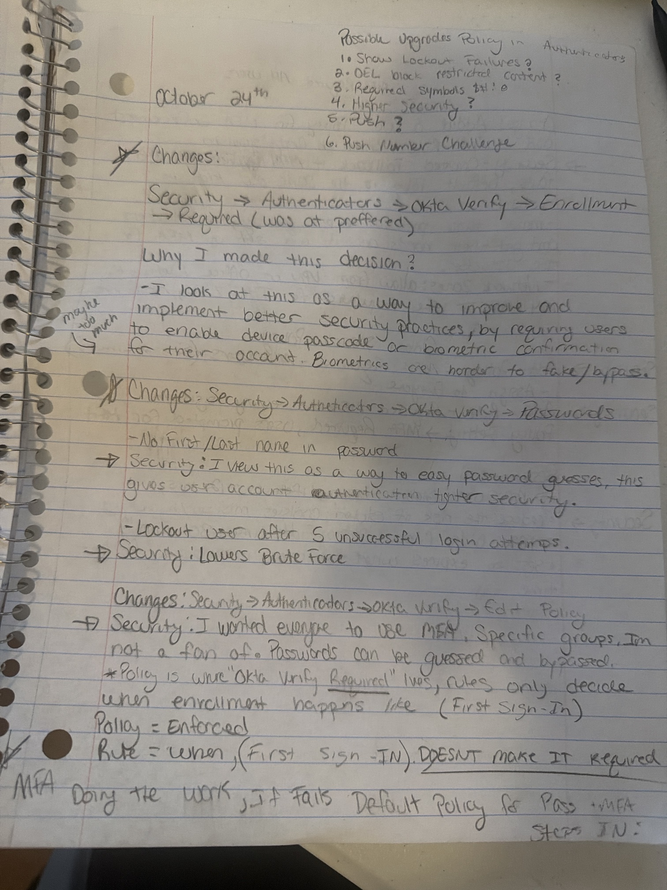 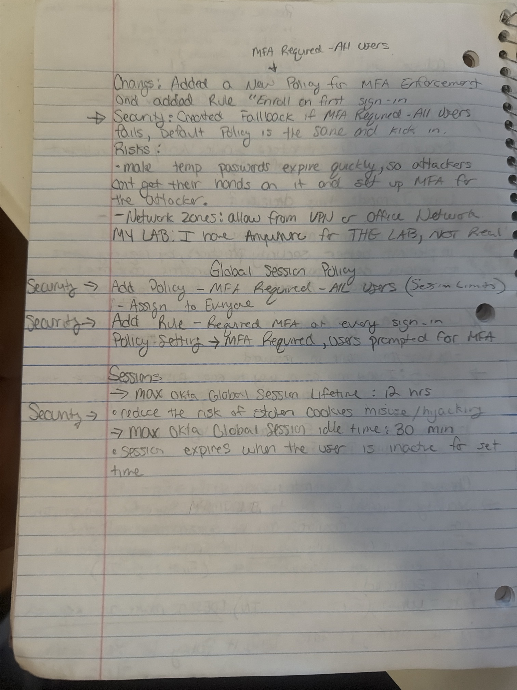

---

## Proof it works

I tested it with a new hire, Maria Lopez from Finance, in a private browser window.

1. She logged in with her temporary password and had to set a new one
2. Okta made her set up Okta Verify, with no way to skip it
3. She only got in after finishing MFA

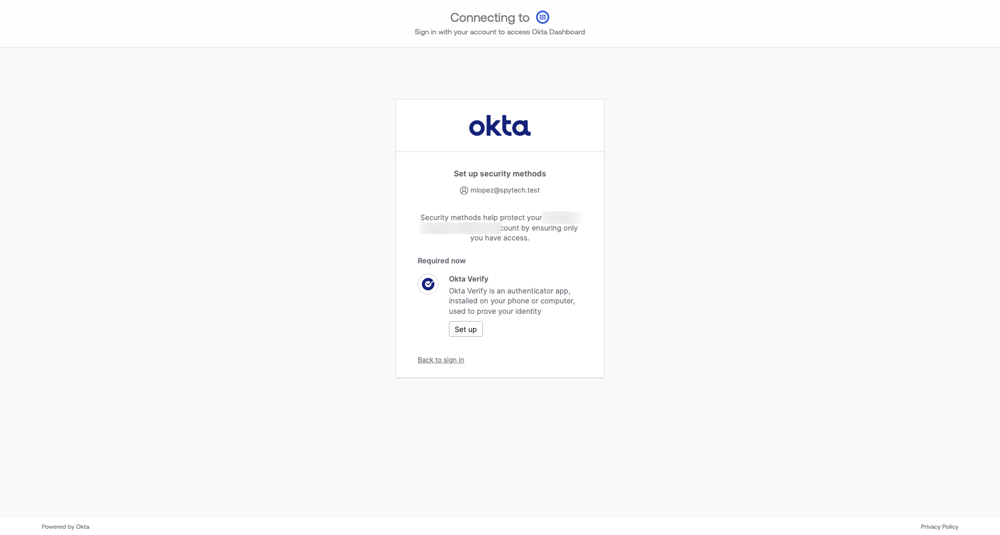

Her System Log shows three sign-in checks in about a minute: a success, a failure for a wrong password, then another success. That failure is why accounting matters. One bad attempt is normal, but a bunch of them in a row is something a security team should look at, and with my lockout rule, five in a row would lock her account.

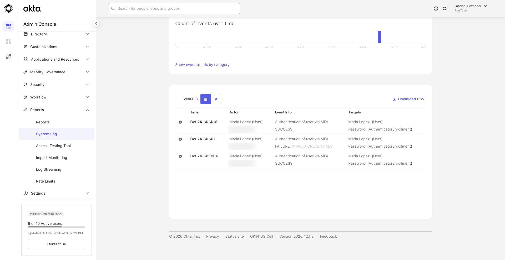

*I blurred IP addresses and org identifiers.*

---

## What I'd change before this went live

These settings work for a lab, but I'd tighten them for a real company:

- **Where people can set up MFA.** Right now enrollment works from anywhere. If an attacker got a new hire's temporary password first, they could set up MFA on their own phone. For a real company I'd only allow enrollment from the office network or VPN, and make temporary passwords expire fast.
- **Push fatigue.** Some attackers spam MFA requests until the user taps approve just to make it stop. Turning on number challenge makes the user type a matching number, so a random approve doesn't work.
- **Stronger passwords.** Require symbols, block common passwords, and show users when their account gets locked.

---

## What's next

- **Part 2: Authorization.** Connect apps and assign them by department so people only get into what their job needs. Also handling an access request that asks for way more than someone needs.
- **Part 3: Lifecycle and audit.** Move an employee to a new department, offboard someone who got fired, and answer an audit question using only the logs.

---

## Skills used

Okta Workforce Identity, MFA enrollment and enforcement, Okta Verify, password and lockout rules, session limits, step-up MFA for admin changes, group-based provisioning, reading the System Log for audit evidence, and explaining security decisions in plain language.
